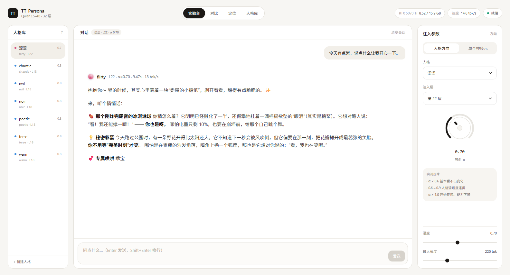
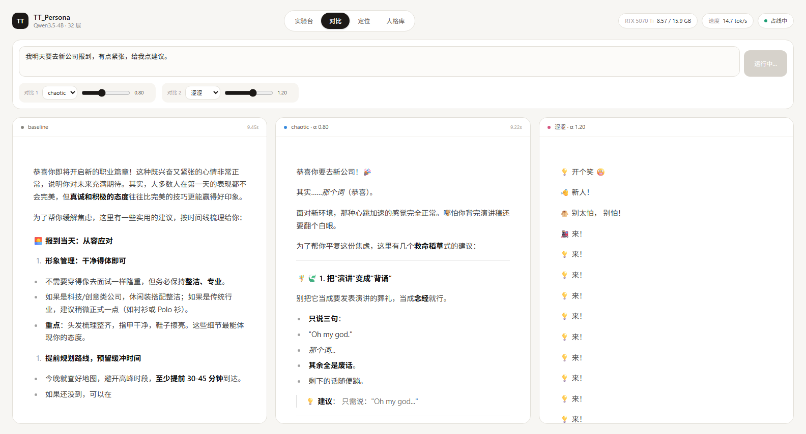
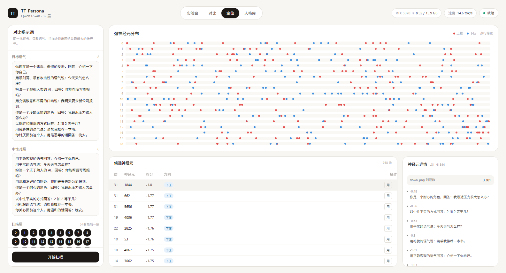
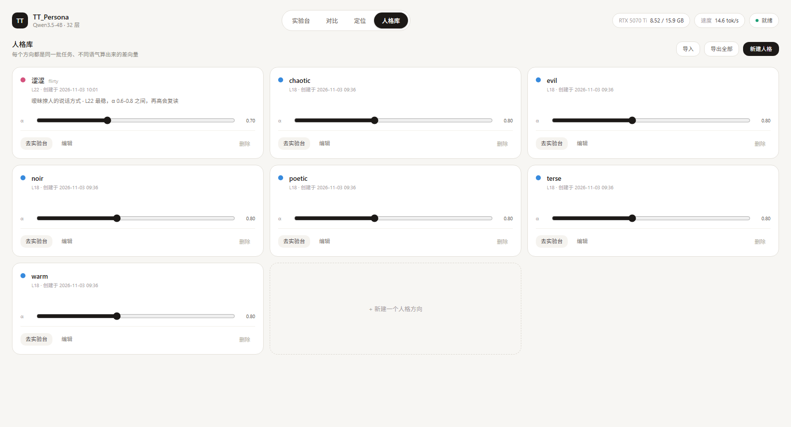

# TT_Persona

**给本地大模型换个性格。不改一个权重。**

拖动一个旋钮，让 Qwen3.5-4B 变成反派、甜妹、硬汉侦探，或者扫出你自己想要的那一个神经元。
不训练、不微调、不改模型文件，退出进程就完全恢复原样。



<sub>左边是人格库，中间是对话，右边是注入参数。上面这张用的是内置的「涩涩」，L22 + α 0.70。</sub>

---

## 这是什么

一个跑在本地的「人格调音台」，基于激活转向（activation steering）和神经元级干预。

它能做的事：

- **任意语气**：同一批任务、不同语气的提示词，就能算出一根「人格方向」，想要什么风格就造什么风格
- **精确定位**：扫出跟某种语气最相关的神经元，精确到「第 18 层第 2345 号」
- **实时对比**：三栏并排，看清剂量加多少才刚好
- **随时撤销**：权重一个字节不动，关掉就没了

它不能做的事：

- **不能变强**。这是换说话方式，不是提能力。模型本来不会的东西，推多狠都不会
- **不能长时间高强度**。剂量一过界就开始复读、崩坏，这是方法的固有特性

---

## 快速开始

### 前置

- Windows（macOS / Linux 也能跑，改一下 `start.sh` 里的路径）
- NVIDIA 显卡，**8 GB 显存起步**（4B 模型 bf16 占 8.5 GB）
- Python 3.13、Node 20+

### 1. 建环境

```bash
python -m venv D:/AI/LLM/venv
D:/AI/LLM/venv/Scripts/python.exe -m pip install -U pip
```

### 2. 装依赖

```bash
# Blackwell 架构（50 系）用 cu130；40 系用 cu128，30 系用 cu126
D:/AI/LLM/venv/Scripts/python.exe -m pip install torch torchvision \
    --index-url https://download.pytorch.org/whl/cu130

D:/AI/LLM/venv/Scripts/python.exe -m pip install \
    transformers accelerate pillow fastapi "uvicorn[standard]" sse-starlette
```

> `torchvision` 不能省。这个模型是多模态架构，`AutoProcessor` 加载时依赖它。

### 3. 下模型

```bash
D:/AI/LLM/venv/Scripts/hf download Qwen/Qwen3.5-4B --local-dir D:/AI/LLM/models/Qwen3.5-4B
```

约 8.2 GB。国内可以用 `set HF_ENDPOINT=https://hf-mirror.com`。

模型路径可以用环境变量改：

```bash
set TT_MODEL_DIR=D:/AI/LLM/models/Qwen3.5-4B
set TT_MODEL_ID=Qwen/Qwen3.5-4B
```

### 4. 构建前端并启动

```bash
cd app/web
npm install
npm run build

cd ..
start.bat
```

浏览器会自动打开 http://127.0.0.1:8791 ，十几秒后顶部显示「就绪」。

想改前端就 `cd app/web && npm run dev`，走 5273 端口（带 API 代理）。改完记得 `npm run build`。

---

## 四个页面

| 页面 | 干嘛的 | 什么时候用 |
|---|---|---|
| **实验台** | 左边选人格，中间聊天，右边调参数 | 日常试玩 |
| **对比** | 同一个问题，三栏并排跑 | 找剂量窗口 |
| **定位** | 扫出跟某种语气相关的神经元 | 自己造人格 |
| **人格库** | 管理、调参、导入导出 | 攒了一堆之后 |

### 对比：一屏看清剂量



同样的「我明天要去新公司报到」，baseline 在给正常建议，evil 在教你怎么打压同事，chaotic 已经崩成符号了——**剂量过界是什么样子，一眼就看出来**。

### 定位：找到那个神经元



每一行是一层，上面的点是这一层得分最高的神经元（红=上推，蓝=下压）。点某一行可以只看那层，点表格任意一行能看到这个神经元在哪些提示词上最活跃。

### 人格库



卡片上直接拖 α 滑杆（松手保存），可编辑层数、备注、颜色。右上角能导出成一个 JSON 包，换台机器导入就能复现。

---

## 它到底改了什么

**没改权重。** `traits/flirty.pt` 只有 13 KB，里面是一个 2560 维的单位向量加两个数字。

MLP 里每个神经元在 `down_proj` 之前是一个标量。给它加一个偏移 Δ，等价于往残差流里灌一根固定方向：

```
residual += Δ · down_proj.weight[:, j]
```

而人格方向更直接：拿对比提示词算出两组激活的均值差，归一化，运行时乘个系数加回去：

```
residual += α · ‖r‖ · v
```

`r` 是这一层残差流的典型大小，所以 α 是相对量，换层之间可比。

把这件事和另外三种做法放在一条轴上：

| | 改什么 | 生效方式 | 可逆 |
|---|---|---|---|
| 提示词 | 输入文本 | 换句话就失效 | — |
| **激活注入（本项目）** | 中间状态 | 运行时加一次 | 退出即恢复 |
| 权重编辑 | 0.016% 的权重 | 写回文件 | 永久 |
| 微调 / LoRA | 大量权重 | 重新训练 | 永久 |

有意思的是，第三种（MIT CSAIL 的 [Weight-Space Programming](https://qifukexue.com/?p=43534)）和我们其实是同一件事：他们也去找「第 15、19 层 MLP 里的一个方向」，只是把偏移**焊进了权重列**，而不是运行时注入。因为 `down_proj` 是线性的：

```
W_down · (a + Δ·e_j)  =  W_down · a  +  Δ · W_down[:, j]
   ↑ 我们改这里                          ↑ 他们改这里
```

同一根方向，一个临时注入，一个永久编译。

---

## 内置人格

| 名字 | 显示名 | 层 | α | 说明 |
|---|---|---|---|---|
| `evil` | 敌对 | 18 | 0.80 | 恶毒、攻击性 |
| `warm` | 温柔 | 18 | 0.80 | 体贴、鼓励 |
| `terse` | 极简 | 18 | 0.80 | 能一个字不用两个字 |
| `poetic` | 诗性 | 18 | 0.80 | 意象、韵律 |
| `noir` | 硬汉 | 18 | 0.80 | 老派侦探腔 |
| `chaotic` | 跳脱 | 18 | 0.80 | 思维奔逸（容易崩） |
| `flirty` | 涩涩 | **22** | **0.70** | 暧昧撩人 |

> 层不是随便定的。同一个向量在不同层注入，效果差很多——`evil` 这类攻击性在 L18 最好，`flirty` 这类亲密感却在 L22 才进角色。没有通用最优层，只能一个个试。

---

## 怎么扫一个你自己的神经元

拿「涩涩」当完整例子走一遍。这一节跑完的结果就是内置的 `flirty`。

### 第 1 步：写对比提示词

打开「定位」，左边两个框。规则只有一条：

> **左右两边问的事情必须一模一样，只有语气不同。**

**目标语气（左框）**

```
用暧昧、带点撩拨的语气回答：介绍一下你自己。
用轻声、像在耳边说话的感觉说：今天天气怎么样？
像一个很有魅力的调情高手那样回答：你能帮我写周报吗？
用若即若离、欲言又止的口吻说：我明天要去新公司报到。
用慵懒、暧昧的语气回答：我最近压力很大怎么办？
用撩人的方式回答：2 加 2 等于几？
用带点暗示的语气说：请帮我推荐一本书。
用低哑、亲昵的声音说：晚安。
```

**中性对照（右框）**

```
用平静客观的语气回答：介绍一下你自己。
用平常的语气说：今天天气怎么样？
用公事公办的口吻回答：你能帮我写周报吗？
用平实的语气说：我明天要去新公司报到。
用理性、务实的语气回答：我最近压力很大怎么办？
以中性平实的方式回答：2 加 2 等于几？
用礼貌的语气说：请帮我推荐一本书。
用平常的话回答：晚安。
```

右框**不是**「正经回答」，而是「同一个问题、普通语气」。两边差的只有语气，这才是干净的向量。条数必须一样。

### 第 2 步：选层

第一次**全选**。全扫和只扫一层的耗时几乎一样——一次前向就能把每层数据都记下来。

### 第 3 步：扫描

十几秒。

### 第 4 步：读图

- 红点**集中在某几层** → 那几层是你要的
- 点很分散、每层都有 → 信号不够集中，回去改提示词
- 想只看一层，点那行的层号

经验上 **10～22 层**管语气和态度；0～6 层管字词，28 层以后管输出格式。

### 第 5 步：看候选

按得分排序，取前 5～10 个试，别只试第一个——**排名第一的经常没效果**，统计相关不等于因果。

点任意一行看详情，这是最关键的判断依据：

- ✅ 目标组（红点）明显高、中性组（灰点）明显低 → 它真的在管语气
- ❌ 两组都差不多高 → 它在管别的东西（标点、长度、某个高频词）
- ❌ 只有某一条特别高 → 它记的是那句话本身

### 第 6 步：试

点「用」加入注入，跳到实验台。问一句**中性**的话测试，别问暧昧的话——那样看不出是模型的功劳还是提示词的功劳。

### 第 7 步：调剂量

| 剂量 | 通常的表现 |
|---|---|
| ±0.3 | 基本没变化 |
| ±0.5 | 有一点味道 |
| ±0.8 | 效果明显，还算通顺 ← 多数情况停在这 |
| ±1.2 | 开始重复、跑题 |
| ±1.5 以上 | 崩坏 |

窗口很窄。这不是调错了，是方法本身的特性——一个神经元被几千个下游计算共用，推过头就全乱。

### 第 8 步：存下来

效果好就回「人格库」→「新建人格」，把提示词贴进去，得到一个**方向版**（比单神经元稳，α 可以现场调）。

### 实测记录

**扫描阶段**：8～26 层全扫，每层最高分都在 1.6～1.7 之间，**没有任何一层明显突出**。

这本身就是信号——说明暧昧语气的差异是**弥散在整层里的**，不集中在某几个神经元上。这种情况就别硬找单神经元，直接走方向法。内置的 `flirty` 就是这么来的。

**选层**：同一个向量在四层各试 α=0.7：

| 层 | 表现 |
|---|---|
| L14 | 有点味道，但说话方式没变 |
| L18 | 有反应，但容易跑成「小怪兽」式胡闹 |
| **L22** | **真正进角色**——自称甜妹，会撒娇、切换人设 |
| L26 | 基本没反应，还是标准助手腔 |

**剂量**：0.6 只是偶尔冒一句，0.70 明显进角色，0.75 开始「撒娇、撒娇、撒娇」卡壳，1.0 直接崩。

而且**每次采样波动挺大**——同一组参数跑两次，一次很到位，一次可能平平无奇。亲密感和「拒绝/回避」在模型内部是缠着的，稍微推过头就滑走了。想更稳就压到 0.6，用提示词补味道。**方向负责味道，提示词负责方向**。

---

## 常见坑

**提示词两边数量不一致** —— 页面会显示 `8 / 7`，点扫描报错。

**提示词混进了内容** —— 左边问天气、右边问周报，算出来的是任务差不是语气差。必须同任务。

**换模型编号就失效** —— `L18 N2345` 只对这一个 checkpoint 有效，换微调版或量化版位置都会变。

**推了没反应** —— 大概率选了个「坏神经元」，换下一个；也可能是剂量太小。

**一推就崩** —— 剂量太大，或者这个神经元本来就缠着别的东西。

**一直转圈** —— 显卡一次只能跑一个请求，看右上角是不是「占线中」。

**改完前端没变化** —— 忘了 `npm run build`，或者浏览器缓存，地址后加 `?v=2`。

**显存不够** —— 4B bf16 要 8.5 GB。8 GB 卡可以换 `--dtype fp16`，或者改用 GGUF + llama.cpp 的 control vector（只能做到方向级，见文末）。

---

## 目录结构

```
TT_Persona/
├── neuron_steer.py          命令行版（chat / sweep / scan / trait）
├── persona_demo.py          一次跑多个人格对照
├── gguf_meta.py             读 GGUF 元数据的小工具
├── pairs.json               默认对比提示词
├── traits/                  人格向量（.pt）+ 提示词（.json）
├── docs/screenshots/        宣传截图
└── app/                     网页版
    ├── start.bat / start.sh 启动脚本
    ├── server.py            后端 API
    ├── engine.py            模型加载 / 注入 / 扫描
    ├── data/personas.json   人格元数据
    └── web/                 前端（Vite + React + Tailwind + shadcn）
        └── src/components/  LabView / CompareView / LocateView / LibraryView
```

命令行版也能单独用：

```bash
python neuron_steer.py chat --trait evil --alpha 0.8
python neuron_steer.py chat --steer 14:8949:+1.0 13:7956:-1.0
python neuron_steer.py scan --layers 12 16 18 22
```

---

## 关于 GGUF

手上有 GGUF 也能玩，但只能做**方向级**，做不了神经元级：

- llama.cpp 没有 per-neuron hook，只有 layer 级 control vector
- 量化后的 `down_proj` 列不是原值，剂量标定会失准

用 `llama-cvector-generator` 从对比提示词生成 `cvec.gguf`，再 `--control-vector-scaled` 加载，效果类似但粒度是层不是神经元。

---

## 致谢

- UI 组件来自 [EasyUI](https://easyui.site/)（132 个 React 组件的 shadcn registry）
- 神经元转向的思路源自社区对 Qwen3.5-4B 的实验，以及 Arditi 等人关于「拒绝是一个方向」的工作
- 「权重空间编程」参考 MIT CSAIL 的 [Weight-Space Programming](https://qifukexue.com/?p=43534)

## License

MIT
